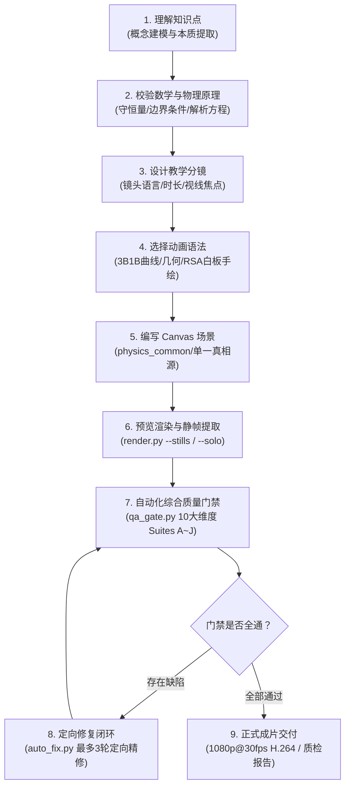

# physics-canvas-video 核心工作流规范 (01-workflow.md)

本 Skill 提供面向物理、数学及工科原理教学动画的工业级闭环工作流：



---

## 步骤一：理解知识点与概念建模

1. **确立教学焦点**：每支短视频（15s ~ 60s）聚焦于一个核心物理或数学本质机制（如两列行波叠加为何产生驻波、LC 电路中能量如何局域互换、卷积中的翻转与滑动窗口物理含义）。
2. **拒绝抽象口号**：画面中必须有明确可追踪的数学/物理实体（波动曲线、电位采样点、电场线、电荷量、积分面积），而不是纯文字幻灯片。

---

## 步骤二：校验数学与物理原理

1. **确立单一真实来源 (SSOT)**：
   - 编写 `physics_config.json`，统一记录空间参数、周期频率、特征方程、边界条件与关键特征点（波节、极值点、平衡点）。
2. **前置数学自洽性检查**：
   - 验证波动相速度 $v = \omega/\beta = \lambda/T$；
   - 验证电磁总能量守恒 $E_e(t) + E_m(t) = \text{const}$；
   - 验证卷积面积守恒律 $\int (f*g)dt = \int f \cdot \int g$。

---

## 步骤三：设计教学分镜 (Storyboard)

编写 `storyboard.md`，规定：
- 全片总时长与镜头切分（单镜头建议 4~8 秒，节奏明快）；
- 镜头运动：原则是“看得清就不动，动必有因”，缓推（push）交代细节，拉远（pull）交代全貌，横移（glide）追踪运动；
- 色板锁定：整片锁定单一画风与调色盘，主波形与辅助图形使用高对比识别色。

---

## 步骤四：选择动画语法与场景划分

- **几何演化与波动曲线**：采用 `t1_3b1b` 语法（暗色高能背景、明亮发光主曲线、半透明势能/面积填充）。
- **物理机理深度总结**：采用 `y3_whiteboard` 语法（暗调科技黑板、象牙白高对比板书笔、亮色墨水笔尖、分层手绘呈现）。

---

## 步骤五：编写 Canvas 场景脚本

1. 引入 `physics_common.js` 工具套件；
2. 坐标系统一：全片所有镜头共用绝对世界坐标与基准平衡线（如 $Y_0 = 550$px），消除镜头切换跳动；
3. 文本与公式排版：使用 `LAYOUT.typesetMath` 排版公式，使用 `LAYOUT.ZONES` 避开字幕带与图形避让区；
4. 运动连续性：指示箭头固定在世界坐标锚点，禁止单帧瞬移取模跳变；
5. 揭示机制解耦：稳态物理曲线采用透明度渐入（Alpha Fade-in），禁止快于相速度的虚假扫掠波前。

---

## 步骤六：预览渲染与静帧抽样

```powershell
# 抽样第 1 镜头静帧快速验证
python src/render.py --solo shot1 --stills 1.0,3.0,5.0 --out stills/shot1

# 快速预览视频
python src/render.py --out draft.mp4 --fps 30
```

---

## 步骤七：自动化综合质量门禁 (QA Gate)

运行 10 大维度门禁套件：
```powershell
python qa/qa_gate.py
```
覆盖 Suite A ~ Suite J：物理参数一致性、公式计算、AABB 遮挡、字体完整性、转场连续性、MP4 流画质、重复确定性、世界坐标连续性、相速度/守恒量验证、镜头密集抽样。

---

## 步骤八：定向修复闭环 (Auto-Fix Loop)

若门禁发现未通过项，运行自动修复工具：
```powershell
python qa/auto_fix.py --max-rounds 3
```
- 最多尝试 3 轮自动修复；
- 每次针对失败维度定向纠正（如同步参数、调整基准避让线、补充离线字体）；
- 逐轮生成 `qa/fix_logs/round_N.log` 完整留存。

---

## 步骤九：正式成片交付

1. 导出全片最终视频 `final.mp4`（1080p @ 30fps，H.264 yuv420p）；
2. 导出最终质检报告 `qa_report.md`；
3. 输出变更日志与物理自洽性检查记录。
