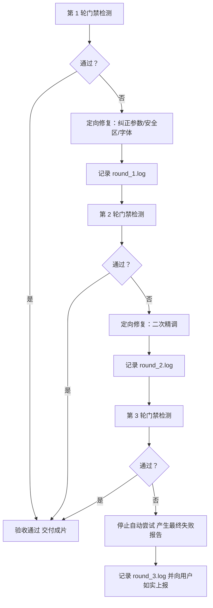

# 自动化 QA 门禁体系与三轮定向修复准则 (06-qa-system-and-rubric.md)

## 一、10 大质量门禁维度 (Suites A ~ J)

`qa_gate.py` 构建了完整的工业级质量门禁，分为静态检查与动态测试两部分：

| 门禁代号 | 质检维度 | 检验核心内容 | 关键判定阈值 |
|---|---|---|---|
| **Suite A** | 物理参数单一真实来源 | `physics_config.json` vs `spec` vs 源码 | 参数 100% 吻合，无误导性机械术语 |
| **Suite B** | 公式计算与定律验证 | 相速度关系、守恒定律、波节残差 | 速度误差 $<0.01\%$, 能量守恒残差 $<10^{-6}$ |
| **Suite C** | 区域几何边界与 AABB 遮挡 | 避让间距、叠字、字幕安全带、马克笔对比度 | 图形避让 $\ge 80\text{px}$, 字幕余量 $\ge 10\text{px}$, 笔对比度 $>10:1$ |
| **Suite D** | 字体缺失与字形回退 | 离线字体文件存在性、控制台字体报错 | 5 套核心中英数字体齐全, 0 运行时字体错误 |
| **Suite E** | 镜头切换与画面异常 | 帧间单帧突变、黑屏空白帧、转场冒烟 | 全片 0 异常跳变, 0 满屏空白帧 |
| **Suite F** | MP4 视频物理流与抽样画质 | 分辨率、帧率、编码、平均亮度、边缘锐度 | 1080p, 30fps, yuv420p, 亮度 $[4, 85]$, 边缘能量 $\ge 1.5$ |
| **Suite G** | 确定性重复渲染测试 | 同一时间戳多次渲染的逐像素比对 | 全镜头帧级重复渲染最大像素差 `det_maxdiff == 0` |
| **Suite H** | **【动态】世界坐标连续性** | 移动箭头/指示物的世界坐标突变分析 | 采样全时段，最大瞬移跳变 $= 0.0\text{px}$ (彻底杜绝跳变) |
| **Suite I** | **【动态】物理变化率与守恒量** | 追踪相速度、能量积分比、平移速率 | 实测相速度误差 $<0.01\%$, 驻波包络速度 $= 0.0\text{px/s}$ |
| **Suite J** | **【动态】镜头边界密集抽样** | 镜头切换点前后的高频时间窗口密集抽样 | 无白闪、无黑场、平滑过渡 |

---

## 二、验收层次与判定原则

1. **自动验证通过 (Hard Gates)**：
   - Suites A, B, C, D, E, F, G, H, I, J 全部判定为 PASS；
   - 任何一项 FAIL 均阻断交付。
2. **人工视觉核验 (Human Visual Check)**：
   - 关键帧抽样：通过 `--stills` 抽取各镜头中间帧，核对构图与排版；
   - 播放流览：以正常速度播放一遍 `final.mp4`，检验运镜节奏与可读性。
3. **未验证项目声明**：
   - 若某主题缺少解析解（如非线性混沌），在 QA 报告中如实列为“数值近似拟合，未作解析闭式验证”。

---

## 三、三轮定向修复协议 (Auto-Fix Protocol)

当门禁检测出可修复缺陷时，由 `auto_fix.py` 驱动自愈循环：

- **最大尝试次数**：严格限制在 3 轮以内，杜绝陷入死循环；
- **逐轮留痕**：每一轮的输入日志、诊断分析、修改动作及前后差异必须完整写入 `<project>/qa/fix_logs/round_N.log`；
- **如实报告**：超过 3 轮仍未通过的缺陷，不掩盖、不伪造，在质检报告中如实列出未解决的技术短板与人工干预建议。
